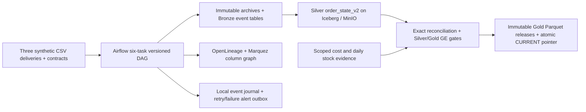

# CartCo Unified Commerce Lakehouse

> Assignment alignment review, 2026-11-11: the verified implementation below is
> not yet the complete assessed B1 stack. Spark batch compute, local IaC, basic
> Grafana and a listed catalog are now confirmed requirements. See the
> [gap matrix](docs/final/assignment-gap-matrix.md) and
> [revised phase plan](docs/final/assignment-aligned-plan.md). Earlier local-scope
> completion statements are superseded by this review.

A verified local medallion lakehouse for three synthetic commerce channels:
Shopify, Amazon and single-product POS. Built by Aadhil A Kareem for Problem B1,
Data Platform & Pipeline Engineering. Licensed under MIT.

The local pipeline supports immutable raw deliveries, source-versioned decimal
order state, reconciled Gold releases, Airflow orchestration, Great Expectations
output gates and OpenLineage/Marquez lineage. Local deployment, scheduler replay,
service backup/restore and a controlled post-commit worker retry have been tested.
This is a local project, not a deployed production service.

## Current architecture



The Iceberg REST catalog persists its SQLite metadata in a named volume.
Airflow and Marquez use separate Postgres databases. Gold release files and
runtime evidence live in the shared data directory; they are not independent
Iceberg mart commits. Earlier Shopify/Amazon/Gold DAGs remain as legacy paths.
The coordinated `versioned_commerce_release` DAG is the recommended path.

## What works

- Three deterministic source generators and delivered CSV/sidecar adapters.
- Hash-addressed raw evidence, immutable completion receipts and replay guards.
- Exact decimal(18,2) INR state with explicit source versions and tombstones.
- Daily revenue, channel performance, customer 360 and category unit sales.
- Optional standard-cost inventory turnover from reconciled stock/cost inputs.
- GE 0.18.19 suites on whole-state keys, active Silver and every Gold artifact.
  Results are persisted in new release manifests; GE failures retain the prior
  pointer and a failure report. Exact-cent reconciliation remains a separate gate.
- Schema/snapshot/column lineage and Gold row-count facets, plus local retry alerts.
- Actual DAG imports/serialization, scheduler dispatch, replay, catalog recreation,
  coordinated volume restore and application boot on isolated restored copies.

## Run a fresh disposable synthetic demo

Requires a Linux Docker engine with Compose, Git and sufficient disk/RAM.
Airflow runs inside Linux containers, not natively on Windows.

```bash
docker compose build
CARTCO_RUNTIME_MODE=synthetic CARTCO_RUNTIME_INVENTORY_MODE=synthetic CARTCO_RUNTIME_ALLOW_EMPTY_INIT=true CARTCO_RUNTIME_ROWS_PER_SOURCE=50 docker compose up -d
docker compose exec -T airflow-scheduler airflow dags unpause versioned_commerce_release
docker compose exec -T airflow-scheduler airflow dags trigger versioned_commerce_release
```

Those environment settings are explicit fixture/empty-initialization permissions
for a disposable demo. Defaults use delivered inputs and disallow empty-state
initialization. Existing installations must preserve their old JDBC catalog
before changing catalog locations. Do not delete volumes to fix startup errors.

Airflow: http://localhost:8080 (`airflow` / `airflow`); MinIO console:
http://localhost:9001 (`minioadmin` / `minioadmin`); Marquez:
http://localhost:3000. These are local demo credentials, not deployment settings.

## Tests and evidence

[Current test report](docs/test_report.md) · [Recovery guide](docs/local-recovery.md)
· [Final walkthrough](docs/final/walkthrough.md) · [Week 4 status](deliverables/week4/status_one_pager.md)

```bash
python -m pip install --require-hashes -r requirements/test.txt
python -m pytest tests/unit
```

Use a separate environment with `requirements/file-integration.txt` for the
real-file suite. Airflow requires SQLAlchemy 1.4; do not upgrade that environment
to run SQLite catalog tests. Container acceptance is in `scripts/ci_baseline.sh`.
Dependencies, Python version and image digests are pinned. Latest verification:
278 unit tests passed (one Windows platform skip), 99 file-integration tests
passed; four strict live integration tests passed in the Docker acceptance run.

## Plan alignment and remaining boundaries

[Original design](docs/B1_Design_Doc.pdf) · [Scope/compute decision](docs/adr/ADR-012-local-completion-scope.md)

The initial scope is three synthetic connectors, not five live API integrations.
Kafka/Feast are bonuses, additional SFTP/ERP sources are extensions, and Terraform
is stretch. PyArrow/PyIceberg is the documented local compute deviation from the
original PySpark selection. Real external alert delivery, cloud deployment,
remote CI for the final branch and a newly published video are not claimed.
Changes remain local under the standing publishing constraint. The reproducible
walkthrough and final written deliverables are supplied; no hosted URL is invented.

Historical walkthroughs: [earlier pipeline](https://canva.link/lwgltzauodnuic5)
and [Week 1](https://canva.link/9vqcf3kxbfiat0n). These precede the completed local
implementation and are not final-version proof.
