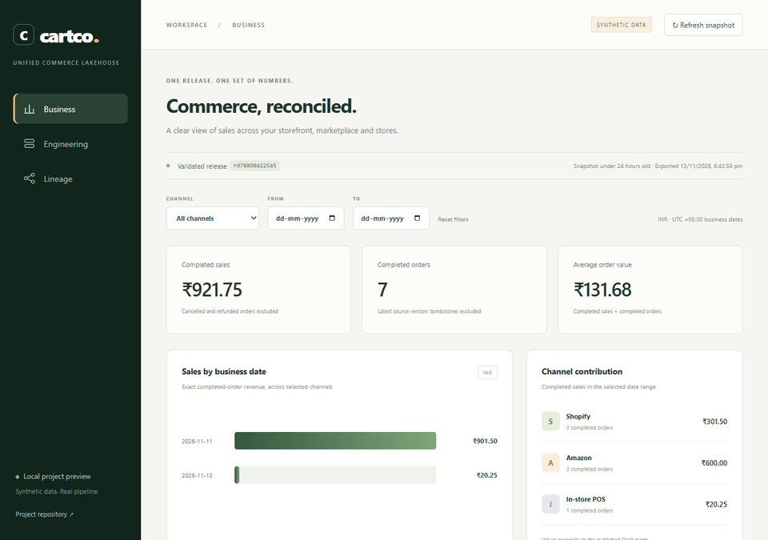
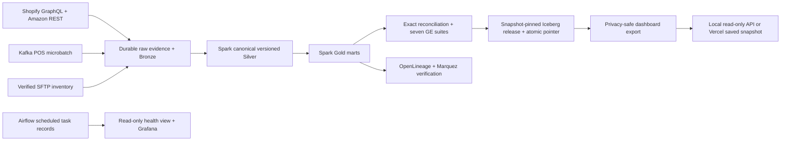

# CartCo Unified Commerce Lakehouse

**Commerce, reconciled.** A synthetic commerce data platform that traces source
deliveries through Spark and Iceberg to one validated business release.

**[Open the public dashboard](https://cartco-lakehouse.vercel.app/)** ·
[Documentation](docs/README.md) · [Verification report](docs/test_report.md) ·
[Run the pipeline](https://github.com/aadhilajas/cartco-lakehouse/actions/workflows/publish-demo.yml)



## What the demonstration shows

Shopify, Amazon and in-store POS describe orders differently. CartCo preserves raw
evidence, resolves source versions and statuses, reconciles exact INR values, and
publishes a coherent release rather than mixing independently changing marts.
SFTP supplies inventory and standard costs as a separate entity.

The historical synthetic fixture has **7 completed orders and INR 921.75 completed
sales**. The dashboard offers Business, Engineering and Lineage views with
channel/date filters, exact money and visible stale/unavailable states. It does
not show live merchant revenue or use real customer data.

## How it is deployed

- **Public website:** Vercel serves the last successfully published snapshot over
  HTTPS. The website remains available between processing runs.
- **On-demand processing:** the owner starts **Publish verified demo** in GitHub
  Actions. A temporary Docker stack runs actual ingestion, scheduled Spark tasks,
  quality/lineage checks, recreation, replay, compaction and browser acceptance.
- **Publication:** only after checks pass, the workflow commits the privacy-safe
  snapshot and run provenance. Vercel deploys the updated main branch.
- **Local stack:** Compose or isolated Terraform retains the full application on
  local named volumes. Airflow, Grafana and data/admin services stay private.

This is an on-demand batch demonstration, not a continuously running, persistent
cloud lakehouse. Temporary GitHub-runner storage is not a durable backend backup.
Refresh on the website reloads results; it does not trigger processing.

The [published provenance](https://cartco-lakehouse.vercel.app/published/publication.json)
links to the producing run. Two publication runs were verified on 14 November
2026: [first run](https://github.com/aadhilajas/cartco-lakehouse/actions/runs/43552077988)
and [update run](https://github.com/aadhilajas/cartco-lakehouse/actions/runs/43554685157).
The public deployment was checked against the second run's release and source
identity. See [deployment checkpoint](docs/validation/public-demo-checkpoint.json).

## Architecture



| Area | Implementation |
|---|---|
| Compute | Spark 3.5.6, Python 3.11, Java 17; bounded single-node execution |
| Tables and catalog | Iceberg 1.12.0, Nessie 0.110.0/JDBC2, PostgreSQL |
| Object storage | MinIO on named local volumes |
| Protocols | Synthetic GraphQL/REST endpoints, Kafka and SSH/SFTP |
| Orchestration | Airflow 2.9.0; four current project DAGs |
| Quality | Independent exact reconciliation and seven Great Expectations suites |
| Lineage and operations | OpenLineage/Marquez and Grafana with a restricted SQL role |
| Dashboard | React/Vite; safe JSON snapshots and exact decimal strings |
| Infrastructure | Shared Compose specification and isolated Terraform Docker resources |

[C4 containers](docs/architecture/assessed-containers.svg) ·
[C4 components](docs/architecture/assessed-components.svg) ·
[Architecture narrative](docs/architecture/assessed-narrative.md) ·
[Deployment decision](docs/adr/ADR-016-public-snapshot-demo.md)

## Run the current application locally

Use Git, Python 3.11, a Linux Docker engine with Compose v2+, network access for
locked dependencies, sufficient RAM and at least 8 GiB free build space.
Airflow runs in Linux containers, not natively on Windows.

```bash
git clone https://github.com/aadhilajas/cartco-lakehouse.git
cd cartco-lakehouse
python scripts/acceptance/run_assessed_stack.py
```

On Windows, with Python and Docker available, the equivalent wrapper is:

```powershell
& .\scripts\windows\Start-CartcoAssessedStack.ps1
```

Open the local dashboard at http://127.0.0.1:18100 after acceptance completes.
Read the [local runbook](docs/assessed-runbook.md) for ports, fixture credentials,
Terraform isolation, logs and preservation rules. Never delete volumes to repair
startup or reset source state. A cold clone-to-run time under 15 minutes is a
target, not a measured guarantee.

**Entrypoint distinction:** root `docker-compose.yml` starts the preserved earlier
application. The current Spark application uses `infra/local/stack.json` and
the runner above. [Infrastructure guide](infra/README.md) explains all three stacks.

## Test and verify

In a clean Python 3.11 virtual environment:

```bash
python -m pip install --require-hashes -r requirements/test.txt
python -m pip check
python -m pytest tests/unit
npm --prefix dashboard ci
npm --prefix dashboard test
npm --prefix dashboard run build
```

Spark reference tests require Java 17 and their separate locked dependencies.
Live acceptance requires Docker. [Testing guide](tests/README.md) explains the
separate environments; [verification report](docs/test_report.md) links evidence.
The hosted build additionally validates the committed public snapshot.

## Repository map

| Directory | Purpose |
|---|---|
| `pipeline/` | Spark compute, state, reference reconciliation and release logic |
| `ingestion/protocols/` | Current bounded source connectors and synthetic fixtures |
| `dashboard/` | Website, publication helpers and UI tests |
| `infra/` | Current stack, baseline compatibility infrastructure and Terraform |
| `scripts/` | Development, acceptance, recovery and diagnostic entrypoints |
| `tests/` | Unit, real-file, Spark and live baseline tests |
| `contracts/` | Business rules and genuine owner-review status |
| `docs/` | Current guides, decisions, evidence and labelled historical material |
| `deliverables/` | Dated assignment submissions and historical evidence |
| `dags/`, `transforms/`, `lineage/` | Preserved baseline paths and shared reference logic |

Earlier modules still support regression tests and independent calculations;
these directories are not all unused legacy code. Start with the
[documentation index](docs/README.md) and [contribution guide](CONTRIBUTING.md).

## Scope and remaining submission work

Implemented checks include scheduled protocol ingestion, exact-decimal Spark
outputs, quality gates, backend lineage, Grafana access, replay, table behavior,
local cold restore and Terraform convergence. The public snapshot update flow
has been verified end to end.

Genuine [contract owner review](contracts/OWNER_REVIEW.md) remains pending. A final
narrated walkthrough remains unrecorded in the project checklist. A rubric that
requires persistent cloud backend services needs separate review: this deployment
does not claim that capability. [Current status](docs/local-completion-checklist.md)
records these boundaries. Older descriptions are preserved in
[historical documentation](docs/history/README.md).

## License

MIT; see [LICENSE](LICENSE). Built by Aadhil A Kareem for Problem B1, Data Platform
& Pipeline Engineering. All demonstrated commerce data is synthetic.
