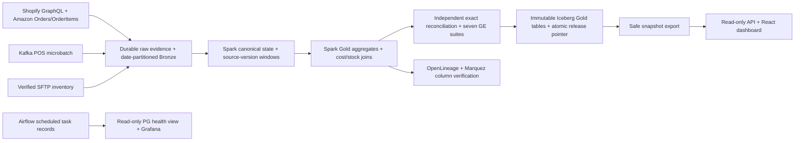
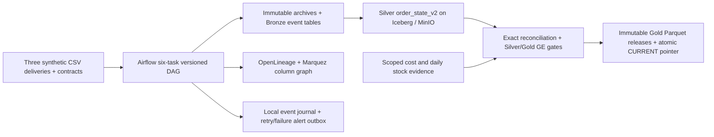

# CartCo Unified Commerce Lakehouse

> Current project update, 13 November 2026: local protocol, Spark/reference,
> quality/lineage, browser, scheduled Compose, cold backup/restore and expanded
> Terraform acceptance passed. The final Terraform plan has no changes. Original
> CartCo data is preserved. GitHub integration, remote CI and public hosting are
> the next manual/external steps; no public URL is claimed.

**Commerce, reconciled.** A synthetic data platform that makes business results
traceable from source delivery to a coherent, validated Iceberg release.

## Demo and business problem

Different source systems describe orders, versions, statuses and inventory in
different ways. CartCo preserves the original evidence, applies explicit source
contracts, and publishes one reconciled release instead of mixing independently
changing marts. The sample is deliberately synthetic; no seller accounts or
customer data are required.

The new React dashboard has Business, Engineering and Lineage views. It uses the
actual privacy-safe release export, exact INR cents, date/channel filters and
visible unavailable/stale states. Refresh reads published data; it cannot run
the pipeline. The verified local sample has seven completed orders and INR
921.75 in completed sales. It is a historical fixture, not live merchant revenue.

After local acceptance, open http://127.0.0.1:18100. There is no verified public
deployment URL yet. See the [project runbook](docs/assessed-runbook.md) and
[current worklist](docs/local-completion-checklist.md).


[Static dashboard screenshot](docs/assets/dashboard-business.png) ·
[Demo provenance and limits](docs/presence_artifact.md)

## Assessed architecture and stack



| Component | Choice | Purpose |
|---|---|---|
| Compute | Spark 3.5.6, Python 3.11, Java 17 | Real DataFrames, windows, joins and batch SQL |
| Table/catalog | Iceberg 1.12.0, Nessie 0.110.0/JDBC2 | Typed, versioned tables with persistent catalog history |
| Storage | MinIO | S3-compatible object storage on named volumes |
| Sources | Synthetic GraphQL/SP-API, Kafka, SSH/SFTP | Bounded real protocol behavior and raw preservation |
| Orchestration | Airflow 2.9.0 | Four meaningful assessed DAGs, retries and readiness sensor |
| Quality | Exact reference reconciliation + GE 0.18.19 | Persisted output gates before publication |
| Lineage | OpenLineage/Marquez | Actual backend schema and column-derivation verification |
| Operations | Grafana + read-only PostgreSQL view | Real DAG states, counts and timing |
| Serving | React 19.3.1/Vite 8.3.8 + stdlib read-only API | Coherent synthetic release dashboard |
| IaC | Terraform 1.13.5, Docker provider 3.6.2 | Shared isolated service specification and protected volumes |

Airflow and Spark use separate Python environments. The assessed task container
has a bounded local Spark runtime; it has no mounted Docker socket. Only one
heavy task runs at once. Source and data/admin services stay private; published
host ports bind loopback.

[C4 Container SVG](docs/architecture/assessed-containers.svg) ·
[C4 Component SVG](docs/architecture/assessed-components.svg) ·
[Architecture narrative](docs/architecture/assessed-narrative.md)

## Prerequisites, install and run

Use Git, Python 3.11+, a running Linux Docker engine/Compose, sufficient RAM and
at least 8 GiB free build space. Dependencies, image digests and jar checksums
are locked. A cold clone-to-run time below 15 minutes is a target requiring a
measured run, not an asserted result.

```bash
git clone https://github.com/aadhilajas/cartco-lakehouse.git
cd cartco-lakehouse
# Select the actual reviewed branch/commit after manual GitHub integration.
python scripts/run_assessed_stack.py
```

On Windows, use normal PowerShell and
`& .\scripts\Start-CartcoAssessedStack.ps1`. Full logs are retained in
`test-results/assessed/`. The script checks actual scheduled DAGs, Grafana and the
dashboard. It preserves the original baseline and prior Phase 1 volumes. A
`SUCCESS.txt` is produced only for a completed acceptance run.

The [runbook](docs/assessed-runbook.md) lists ports, fixture credentials, repeat
runs, Terraform isolation and preservation rules. Do not delete volumes or reset
Kafka offsets to repair a failed run.

## Test

```bash
python -m pip install --require-hashes -r requirements/test.txt
python -m pytest tests/unit
npm --prefix dashboard ci
npm --prefix dashboard test
npm --prefix dashboard run build
```

Real Spark/reference tests are under `tests/spark` and require the separate
locked Spark dependencies and Java 17. Live scheduled-stack tests use the host
runner. The prepared assessed GitHub workflow covers dashboard, Spark reference
and the actual scheduled container path; it has not run remotely yet.

Current evidence is scoped: 296 unit tests passed with one Windows FIFO skip;
three native Spark comparisons passed; the real protocol and catalogued candidate
passed exact/GE gates. Backend Marquez checks verified 44 schema fields and 34
nonconstant derivations. The browser checked filters, mobile layout, failed-refresh
retention and read-only routes. New ratio-edge, expanded container, recovery and
remote checks must pass separately before those claims are added.

## Data and contracts

The frozen demonstration date is 12 November 2026. Shopify and Amazon each
deliver three bounded single-line orders. POS contributes duplicate, late,
updated and deleted events across two Kafka partitions. SFTP contributes daily
stock and fixed standard cost for eight source-qualified SKU/location pools.
Raw evidence, broker offsets and source/batch IDs stay traceable.

Silver keeps channel-qualified keys, exact decimal INR, canonical business dates,
source versions and tombstones. Five catalogued Gold outputs cover daily revenue,
channel performance, customer 360, inventory turnover and retained category unit
sales. Inventory uses actual declared cost/stock; customer matching is not
fabricated across channels. Public exports omit customer IDs and raw/private data.
See [protocol contracts](docs/protocol-connectors.md).

## Decisions, limitations and roadmap

See [ADR-013](docs/adr/ADR-013-spark-nessie-infrastructure.md),
[ADR-014](docs/adr/ADR-014-bounded-protocol-ingestion.md) and
[ADR-015](docs/adr/ADR-015-spark-state-and-release-publication.md), alongside the
preserved earlier ADRs.

This is a bounded synthetic project, not production merchant onboarding, HA or
sub-second streaming. The pinned Marquez images are amd64-only; an ARM host needs
separate qualification. Free account/capacity and secure hosted operation remain
open. No paid resources or fabricated public links are included.

Finish the [local checklist](docs/local-completion-checklist.md), then follow
[manual GitHub integration](docs/manual-github-integration.md) and
[manual hosting](docs/manual-hosting.md). Personal resume/interview work is outside
the user's current requested scope. New work keeps its genuine November dates.

## License and acknowledgements

MIT; see [LICENSE](LICENSE). Built by Aadhil A Kareem for Problem B1, Data Platform
& Pipeline Engineering. The repository acknowledges the open-source projects
listed in the stack and links primary protocol documentation in the runbook.

## Preserved baseline documentation

The sections below describe the earlier PyArrow/PyIceberg application and its
historical evidence. It remains a regression reference. It is not the new
assessed Spark entrypoint described above.

> Assignment alignment review, 2026-11-11: the verified implementation below is
> not yet the complete assessed B1 stack. Spark batch compute, local IaC, basic
> Grafana and a listed catalog are now confirmed requirements. See the
> [gap matrix](docs/final/assignment-gap-matrix.md) and
> [revised phase plan](docs/final/assignment-aligned-plan.md). Earlier local-scope
> completion statements are superseded by this review.

A verified local medallion lakehouse for three synthetic commerce channels:
Shopify, Amazon and single-product POS. Built by Aadhil A Kareem for Problem B1,
Data Platform & Pipeline Engineering. Licensed under MIT.

The local pipeline supports immutable raw deliveries, source-versioned decimal
order state, reconciled Gold releases, Airflow orchestration, Great Expectations
output gates and OpenLineage/Marquez lineage. Local deployment, scheduler replay,
service backup/restore and a controlled post-commit worker retry have been tested.
This is a local project, not a deployed production service.

## Current architecture



The Iceberg REST catalog persists its SQLite metadata in a named volume.
Airflow and Marquez use separate Postgres databases. Gold release files and
runtime evidence live in the shared data directory; they are not independent
Iceberg mart commits. Earlier Shopify/Amazon/Gold DAGs remain as legacy paths.
The coordinated `versioned_commerce_release` DAG is the recommended path.

## What works

- Three deterministic source generators and delivered CSV/sidecar adapters.
- Hash-addressed raw evidence, immutable completion receipts and replay guards.
- Exact decimal(18,2) INR state with explicit source versions and tombstones.
- Daily revenue, channel performance, customer 360 and category unit sales.
- Optional standard-cost inventory turnover from reconciled stock/cost inputs.
- GE 0.18.19 suites on whole-state keys, active Silver and every Gold artifact.
  Results are persisted in new release manifests; GE failures retain the prior
  pointer and a failure report. Exact-cent reconciliation remains a separate gate.
- Schema/snapshot/column lineage and Gold row-count facets, plus local retry alerts.
- Actual DAG imports/serialization, scheduler dispatch, replay, catalog recreation,
  coordinated volume restore and application boot on isolated restored copies.

## Run a fresh disposable synthetic demo

Requires a Linux Docker engine with Compose, Git and sufficient disk/RAM.
Airflow runs inside Linux containers, not natively on Windows.

```bash
docker compose build
CARTCO_RUNTIME_MODE=synthetic CARTCO_RUNTIME_INVENTORY_MODE=synthetic CARTCO_RUNTIME_ALLOW_EMPTY_INIT=true CARTCO_RUNTIME_ROWS_PER_SOURCE=50 docker compose up -d
docker compose exec -T airflow-scheduler airflow dags unpause versioned_commerce_release
docker compose exec -T airflow-scheduler airflow dags trigger versioned_commerce_release
```

Those environment settings are explicit fixture/empty-initialization permissions
for a disposable demo. Defaults use delivered inputs and disallow empty-state
initialization. Existing installations must preserve their old JDBC catalog
before changing catalog locations. Do not delete volumes to fix startup errors.

Airflow: http://localhost:8080 (`airflow` / `airflow`); MinIO console:
http://localhost:9001 (`minioadmin` / `minioadmin`); Marquez:
http://localhost:3000. These are local demo credentials, not deployment settings.

## Tests and evidence

[Current test report](docs/test_report.md) · [Recovery guide](docs/local-recovery.md)
· [Final walkthrough](docs/final/walkthrough.md) · [Week 4 status](deliverables/week4/status_one_pager.md)

```bash
python -m pip install --require-hashes -r requirements/test.txt
python -m pytest tests/unit
```

Use a separate environment with `requirements/file-integration.txt` for the
real-file suite. Airflow requires SQLAlchemy 1.4; do not upgrade that environment
to run SQLite catalog tests. Container acceptance is in `scripts/ci_baseline.sh`.
Dependencies, Python version and image digests are pinned. Latest verification:
287 unit tests passed (one Windows platform skip), 99 file-integration tests
passed; four strict live integration tests passed in the Docker acceptance run.

## Phase 1 infrastructure

The isolated Spark/Nessie foundation passed local Compose and real Terraform
apply/recreation acceptance on 12 November 2026. All nine Spark compatibility
checks and exact persistence comparisons passed. Hosted deployment and ARM
execution remain unverified; commerce Spark transformations belong to later phases. See the [runbook and evidence ledger](docs/phase1-infrastructure.md).
The original stack and retained data remain the regression baseline.

## Plan alignment and remaining boundaries

[Original design](docs/B1_Design_Doc.pdf) · [Scope/compute decision](docs/adr/ADR-012-local-completion-scope.md)

The current target requires all four connectors (Shopify GraphQL, Amazon SP-API,
Kafka POS and SFTP), real PySpark batch work, Terraform, Grafana and a listed
catalog. The tested PyArrow/PyIceberg baseline is preserved while these gaps are
closed. A hosted backend and public dashboard are required for the 1 December
2026 viva; hosting feasibility is unresolved under the confirmed zero budget.
Reviewed code and dashboard publication is authorized when ready. Final remote
CI, deployment and recordings are not yet claimed. See the
[assignment-aligned plan](docs/final/assignment-aligned-plan.md) and
[hosting feasibility](docs/final/hosting-feasibility.md).

Historical walkthroughs: [earlier pipeline](https://canva.link/lwgltzauodnuic5)
and [Week 1](https://canva.link/9vqcf3kxbfiat0n). These precede the completed local
implementation and are not final-version proof.
