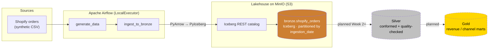

# CartCo Unified Commerce Lakehouse

**One trusted source of truth for revenue across CartCo's sales channels.**

[](LICENSE)
[-orange)](deliverables/week1/status_one_pager.md)

A medallion (Bronze → Silver → Gold) lakehouse that ingests CartCo's multi-channel sales data and publishes reconciled, analytics-ready marts.

- **Problem code:** B1 — Unified Commerce Lakehouse
- **Segment:** Data Platform & Pipeline Engineering
- **Author:** Aadhil A Kareem
- **Target roles:** Data Engineer · Data Platform Engineer · Analytics Engineer

---

## Demo

> **Loom walkthrough:** `https://canva.link/9vqcf3kxbfiat0n` — will show the Docker stack coming up, the `shopify_bronze_ingestion` DAG running to success in Airflow, and a read-back of `bronze.shopify_orders` from the Iceberg table on MinIO.

---

## Problem Statement

CartCo is a multi-channel retailer selling through several disconnected systems — its own Shopify D2C website, the Amazon marketplace, physical stores (POS), and distributor SFTP feeds. Each system reports orders and revenue on its own schedule with its own schema, so finance cannot trust a single revenue number, marketing cannot attribute channel performance, and operations has no unified view. This project builds a medallion lakehouse that lands raw data from each channel unchanged in a **Bronze** layer, will conform and quality-check it in a **Silver** layer, and will publish business-facing **Gold** marts — giving CartCo one reconciled revenue figure and channel-level insight. Week 1 delivers the platform foundation and the first end-to-end Bronze ingestion for the Shopify channel.

---

## Architecture



Airflow orchestrates a two-task DAG: `generate_data` produces a synthetic Shopify orders CSV, then `ingest_to_bronze` writes it as an Apache Iceberg table on MinIO through the Iceberg REST catalog, partitioned by `ingestion_date` and written idempotently (partition-level overwrite). Silver and Gold layers are stubbed and planned for later weeks. A fuller C4-style diagram is available at [`deliverables/week1/architecture_diagram/cartco_architecture.pdf`](deliverables/week1/architecture_diagram/cartco_architecture.pdf).

---

## Tech Stack

Only tools actually used in the current (Week 1) codebase are listed.

| Component | Choice | Why |
|-----------|--------|-----|
| Ingestion | Python + Faker + pandas | Deterministic, seeded synthetic Shopify order generation (`ingestion/generate_synthetic_shopify_data.py`) |
| Storage | MinIO (S3-compatible) | Local object store for the lakehouse; same S3 API as production |
| Table format | Apache Iceberg (via PyIceberg) | ACID writes and partition-level overwrite enable idempotent, `ingestion_date`-partitioned Bronze loads |
| Catalog | Iceberg REST catalog (`tabulario/iceberg-rest`) | Serves Iceberg metadata over REST; backs the `bronze` namespace against MinIO |
| Compute | PyArrow + PyIceberg | CSV → Arrow → Iceberg write path used by the Bronze load today (PySpark is installed in the image but not yet used — reserved for Silver/Gold) |
| Orchestration | Apache Airflow (LocalExecutor) | Runs the two-task Bronze DAG on a single machine; no Celery/Redis to operate |
| Metadata DB | PostgreSQL 14 | Airflow metadata backend |
| Observability | Airflow run history + task logs | The only observability wired in Week 1; OpenLineage + Marquez are deferred to Week 2 |

---

## Quickstart

### Prerequisites

- **Docker Desktop** 4.x with **Docker Compose v2**
- **Git** 2.30+
- **~8 GB RAM** available for the containers (Airflow + MinIO + Postgres + Iceberg REST)

### Install

```bash
git clone https://github.com/aadhilajas/cartco-lakehouse.git
cd cartco-lakehouse

# Build the custom Airflow image (adds PyIceberg, PyArrow, PySpark, Great Expectations, Faker)
docker compose build
```

> There is no `requirements.txt` yet — all runtime dependencies are baked into the Airflow image via `Dockerfile.airflow`.

### Run

```bash
# Start the full local stack
docker compose up -d

# Confirm services are up
docker compose ps

# Trigger the Bronze ingestion DAG
docker exec cartco-airflow-scheduler airflow dags trigger shopify_bronze_ingestion
```

Once running:

| Service | URL | Credentials |
|---------|-----|-------------|
| Airflow UI | http://localhost:8080 | `airflow` / `airflow` |
| MinIO Console | http://localhost:9001 | `minioadmin` / `minioadmin` |
| MinIO S3 API | http://localhost:9000 | `minioadmin` / `minioadmin` |
| Iceberg REST catalog | http://localhost:8181 | — |

### Test

There is **no automated test suite yet** (unit/integration tests are planned for Week 3). Current verification is manual and reproducible:

```bash
# Re-run the ingestion — it is idempotent, so the row count stays the same
docker exec cartco-airflow-scheduler python /opt/airflow/ingestion/shopify_bronze.py
```

The script logs start time, rows read, rows written, and end time, and reads the partition back to confirm the count. Captured proof lives in [`deliverables/week1/screenshots/`](deliverables/week1/screenshots/).

---

## Data

All data is **synthetically generated** — no real PII or production credentials.

- **Source (Week 1):** `ingestion/generate_synthetic_shopify_data.py` produces **50,000** Shopify order rows to `data/raw/shopify_orders.csv` (seeded for reproducibility). The `data/` folder is git-ignored.
- **Columns:** `order_id` (uuid), `customer_id`, `channel` (always `shopify`), `order_date` (spread over ~2 years), `product_id`, `product_category`, `quantity`, `unit_price`, `status` (delivered / cancelled / returned, weighted).
- **Bronze table:** `bronze.shopify_orders`, an Iceberg table on MinIO with an added `ingestion_date` column and partitioned by `ingestion_date=YYYY-MM-DD` (load date, distinct from the business `order_date`).

Planned sources (not yet implemented) and schema notes are documented in [`docs/data.md`](docs/data.md).

---

## Architecture Decision Records

| ADR | Summary |
|-----|---------|
| [ADR-001](docs/adr/ADR-001-table-format-choice.md) | Apache Iceberg for ACID writes, partition evolution, and multi-engine support |
| [ADR-002](docs/adr/ADR-002-orchestrator-choice.md) | Apache Airflow (LocalExecutor) for batch DAG orchestration |
| [ADR-003](docs/adr/ADR-003-partition-strategy.md) | `ingestion_date=YYYY-MM-DD` partitioning across Bronze and downstream layers |
| [ADR-004](docs/adr/ADR-004-ingestion-tool-choice.md) | Per-source ingestion scripts orchestrated by Airflow |
| [ADR-005](docs/adr/ADR-005-schema-evolution-policy.md) | Bronze accepts source columns; Silver enforces the canonical schema |

---

## Known Limitations

- **Only the Shopify source is implemented.** `ingestion/amazon_bronze.py`, `kafka_instore_bronze.py`, and `sftp_distributor_bronze.py` are stubs with no logic yet.
- **Bronze uses PyIceberg + PyArrow, not Spark.** PySpark is installed in the Airflow image but is not yet used in any script — it is reserved for the heavier Silver/Gold transforms. Compute currently runs in-process inside the Airflow container, not on a separate Spark cluster.
- **No Silver or Gold layers yet**, and therefore **no Great Expectations checkpoints** are wired (Bronze intentionally has no validation, per the layer rules).
- **Lineage (OpenLineage + Marquez) is not wired up** — deferred to Week 2.
- **Stack is local-only and not production-hardened** — default credentials, no TLS, no secrets management, no cloud deployment.
- **No automated tests yet** — verification is currently manual (DAG run + read-back).

---

## Roadmap

- **Week 2 — Skinny end-to-end slice:** add the Amazon Bronze connector; build the first Silver transform (`silver.shopify_orders`: schema enforcement + dedup) with a Great Expectations checkpoint gating the write; wire OpenLineage → Marquez for lineage.
- **Week 3 — Hardening:** unit + integration tests for the ingestion/transform code; a first Gold revenue mart; error-handling and logging audit.
- **Week 4 — Production polish:** remaining channel connectors, customer-360 Gold mart, and infrastructure/deployment configs (IaC + hardened Docker).

---

## License

Licensed under the [MIT License](LICENSE).

## Acknowledgements

Built as part of a Data Platform & Pipeline Engineering internship (Problem Code B1) using the CartCo business scenario.
