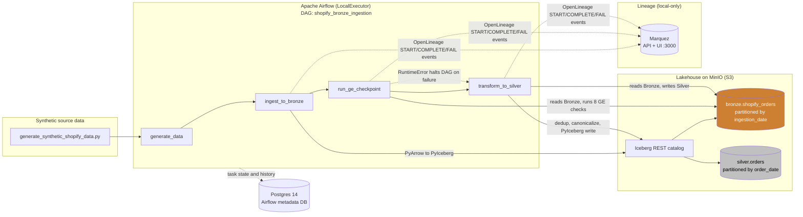

# CartCo Unified Commerce Lakehouse

> **Phase 1 work in progress:** current setup, dependency locks and verification status are in [the baseline guide](docs/phase1/README.md). Amazon and Gold implementations already exist; several historical sections below predate them.

**One trusted source of truth for revenue across CartCo's sales channels.**

[](LICENSE)
[-blue)](deliverables/week3/status_one_pager.md)

A medallion (Bronze → Silver → Gold) lakehouse that ingests CartCo's multi-channel sales data and publishes reconciled, analytics-ready marts.

- **Problem code:** B1 — Unified Commerce Lakehouse
- **Segment:** Data Platform & Pipeline Engineering
- **Author:** Aadhil A Kareem
- **Target roles:** Data Engineer · Data Platform Engineer · Analytics Engineer

---

## Demo

> **Latest Loom walkthrough:** https://canva.link/lwgltzauodnuic5
>
> **Live deployment:** [LIVE_URL] *(not yet deployed — the stack runs locally via Docker Compose; see [Quickstart](#quickstart))*

**Previous demos:**
- **Week 1:** `https://canva.link/9vqcf3kxbfiat0n` — Docker stack startup, `shopify_bronze_ingestion` DAG green, `bronze.shopify_orders` read-back.

**Jump to:** [Quickstart](#quickstart) · [Testing](docs/test_report.md) · [Lineage](docs/lineage.md) · [ADRs](#architecture-decision-records) · [Known Limitations](#known-limitations) · [Week 2 proof](deliverables/week2/) · [Week 3 proof](deliverables/week3/)

---

## Problem Statement

CartCo is a multi-channel retailer selling through several disconnected systems — its own Shopify D2C website, the Amazon marketplace, physical stores (POS), and distributor SFTP feeds. Each system reports orders and revenue on its own schedule with its own schema, so finance cannot trust a single revenue number, marketing cannot attribute channel performance, and operations has no unified view. This project builds a medallion lakehouse that lands raw data from each channel unchanged in a **Bronze** layer, conforms and quality-checks it in a **Silver** layer, and will publish business-facing **Gold** marts — giving CartCo one reconciled revenue figure and channel-level insight. As of Week 3, the Shopify channel has a complete, verified Bronze → quality gate → Silver path, an automated test suite wired into CI, and OpenLineage lineage for that path visible in Marquez; Amazon, in-store, and distributor connectors and all Gold marts remain future work.

---

## Architecture



Airflow orchestrates a 4-task DAG: `generate_data` produces a synthetic Shopify orders CSV; `ingest_to_bronze` writes it to `bronze.shopify_orders` (Iceberg on MinIO via the Iceberg REST catalog), partitioned by `ingestion_date` and written idempotently (partition-level overwrite); `run_ge_checkpoint` reads Bronze back and runs 8 Great Expectations checks, raising and halting the DAG if any fail; `transform_to_silver` reads Bronze, deduplicates, canonicalizes `status` → `order_status`, and writes `silver.orders` partitioned by `order_date` with a date-range idempotent overwrite. This chain has been run end-to-end against the live stack with all 4 tasks succeeding. Each of the three data-touching tasks (`ingest_to_bronze`, `run_ge_checkpoint`, `transform_to_silver`) also emits OpenLineage events directly to Marquez via [`lineage/emitter.py`](lineage/emitter.py) — see [`docs/lineage.md`](docs/lineage.md) for exactly what that covers. Gold layer marts are not yet built. The current-state diagram above is kept in sync with [`deliverables/week2/architecture_diagram/current_state_architecture.md`](deliverables/week2/architecture_diagram/current_state_architecture.md), which also documents each component. The original full target-state design (all five channels, Gold, analytics) is in [`docs/B1_Design_Doc.pdf`](docs/B1_Design_Doc.pdf).

---

## Tech Stack

Only tools actually used in the current (Week 3) codebase are listed.

| Component | Choice | Why |
|-----------|--------|-----|
| Ingestion | Python + Faker + pandas | Deterministic, seeded synthetic Shopify order generation (`ingestion/generate_synthetic_shopify_data.py`) |
| Storage | MinIO (S3-compatible) | Local object store for the lakehouse; same S3 API as production |
| Table format | Apache Iceberg (via PyIceberg 0.7.1) | ACID writes and partition-level/range overwrite enable idempotent Bronze (`ingestion_date`) and Silver (`order_date`) loads |
| Catalog | Iceberg REST catalog (`tabulario/iceberg-rest`) | Serves Iceberg metadata over REST; backs the `bronze` and `silver` namespaces against MinIO |
| Compute (Bronze/Silver) | PyArrow + PyIceberg | CSV → Arrow → Iceberg for Bronze; Arrow-only (no pandas) transforms — dedup, null handling, canonicalization — for Silver |
| Data quality | Great Expectations 0.18.19 (Fluent API, ephemeral context) | In-memory 8-expectation gate on `bronze.shopify_orders` before Silver runs; no filesystem writes, no checkpoint store |
| Orchestration | Apache Airflow (LocalExecutor) | Runs the 4-task DAG (`generate_data → ingest_to_bronze → run_ge_checkpoint → transform_to_silver`) on a single machine; no Celery/Redis to operate |
| Metadata DB | PostgreSQL 14 | Airflow metadata backend (separate from Marquez's own Postgres) |
| Lineage | OpenLineage client (`openlineage-python==1.11.3`) + Marquez (`marquezproject/marquez:0.51.1`) | Manual `START`/`COMPLETE`/`FAIL` emission from `lineage/emitter.py` for the 3 data-touching Shopify tasks; see [`docs/lineage.md`](docs/lineage.md) for exact coverage and why manual emission was chosen over Airflow's automatic OpenLineage listener (disabled via `AIRFLOW__OPENLINEAGE__DISABLED`) |
| Testing | pytest 8.3.3 | 14 unit tests (`tests/unit/`) + 2 opt-in integration tests (`tests/integration/`) against the live stack; wired into GitHub Actions (`.github/workflows/ci.yml`) |
| Observability | Airflow run history + task logs + Marquez lineage graph | See [`docs/lineage.md`](docs/lineage.md) for exactly what the lineage graph does and doesn't cover |

PySpark is installed in the Airflow image (`Dockerfile.airflow`) but is not used by any script yet — Bronze and Silver both run on PyArrow/PyIceberg in-process inside the Airflow container.

---

## Quickstart

### Prerequisites

- **Docker Desktop** 4.x with **Docker Compose v2**
- **Git** 2.30+
- **~8 GB RAM** available for the containers (Airflow + MinIO + Postgres + Iceberg REST)

### Install

```bash
git clone https://github.com/aadhilajas/cartco-lakehouse.git
cd cartco-lakehouse

# Build the custom Airflow image (adds PyIceberg, PyArrow, PySpark, Great Expectations, Faker)
docker compose build
```

> Runtime and test dependencies are now centrally pinned under [`requirements/`](requirements/README.md); the Airflow image uses the Linux/Python 3.11 lock.

### Run

```bash
# Start the full local stack
docker compose up -d

# Confirm services are up
docker compose ps

# Trigger the Bronze ingestion DAG
docker exec cartco-airflow-scheduler airflow dags trigger shopify_bronze_ingestion
```

Once running:

| Service | URL | Credentials |
|---------|-----|-------------|
| Airflow UI | http://localhost:8080 | `airflow` / `airflow` |
| MinIO Console | http://localhost:9001 | `minioadmin` / `minioadmin` |
| MinIO S3 API | http://localhost:9000 | `minioadmin` / `minioadmin` |
| Iceberg REST catalog | http://localhost:8181 | — |
| Marquez UI (lineage) | http://localhost:3000 | — |
| Marquez API | http://localhost:5000 | — |

### Test

Unit tests (`tests/unit/`, 14 tests) run against pure PyArrow/pandas logic — no Docker needed beyond the dependencies in `tests/requirements-test.txt`:

```bash
pip install -r tests/requirements-test.txt
pytest -m "not integration" tests/unit -v
```

Integration tests (`tests/integration/`, 2 tests, opt-in) need the live stack up with Bronze data already ingested:

```bash
docker exec -e RUN_INTEGRATION_TESTS=1 cartco-airflow-scheduler \
    pytest -m integration tests/integration -v
```

CI (`.github/workflows/ci.yml`) runs the unit tests automatically on every push/PR; integration tests only run when manually triggered from the Actions tab, since they need a full Docker stack CI doesn't provision by default. Full scope, what CI does and doesn't cover, and the known test gaps: [`docs/test_report.md`](docs/test_report.md) (also includes a logging/error-handling audit of the pipeline code).

Beyond the automated suite, manual verification is still how the ingestion script and DAG wiring itself are checked:

```bash
# Re-run any stage directly — Bronze and Silver are both idempotent
docker exec cartco-airflow-scheduler python /opt/airflow/ingestion/shopify_bronze.py
docker exec cartco-airflow-scheduler python /opt/airflow/transforms/ge_bronze_shopify_checkpoint.py
docker exec cartco-airflow-scheduler python /opt/airflow/transforms/silver_shopify_orders.py

# Read back either table
docker exec cartco-airflow-scheduler python -c "
from transforms.silver_shopify_orders import get_catalog
catalog = get_catalog()
print(catalog.load_table('silver.orders').scan().to_arrow().num_rows)
"
```

Each script logs start time, row counts at each stage, and end time; re-running does not duplicate rows (partition-level overwrite for Bronze, date-range overwrite for Silver). Captured proof from a real DAG run lives in [`deliverables/week1/screenshots/`](deliverables/week1/screenshots/) (2-task Bronze run), [`deliverables/week2/screenshots/`](deliverables/week2/screenshots/) (full 4-task run including the GE gate and Silver write), and [`deliverables/week3/lineage_proof.txt`](deliverables/week3/lineage_proof.txt) (OpenLineage events landing in Marquez, verified via the Marquez HTTP API).

### Lineage

```bash
# Marquez comes up automatically with `docker compose up -d` (marquez-db, marquez-api, marquez-web).
# After running the DAG, browse http://localhost:3000, select the cartco-lakehouse namespace, and
# look for the shopify_bronze_ingestion.ingest_to_bronze / .run_ge_checkpoint / .transform_to_silver jobs.
```

Full setup, verification steps, and an explicit statement of what is and isn't covered: [`docs/lineage.md`](docs/lineage.md).

---

## Data

All data is **synthetically generated** — no real PII or production credentials.

- **Source:** `ingestion/generate_synthetic_shopify_data.py` produces **50,000** Shopify order rows to `data/raw/shopify_orders.csv` (seeded for reproducibility). The `data/` folder is git-ignored.
- **Columns:** `order_id` (uuid), `customer_id`, `channel` (always `shopify`), `order_date` (spread over ~2 years), `product_id`, `product_category`, `quantity`, `unit_price`, `status` (`delivered` / `cancelled` / `returned`, weighted — this is Bronze's source-faithful vocabulary).
- **Bronze table:** `bronze.shopify_orders` — an Iceberg table on MinIO with an added `ingestion_date` column, partitioned by `ingestion_date=YYYY-MM-DD` (load date, distinct from the business `order_date`). No filtering, dedup, or business logic applied.
- **Great Expectations gate:** `transforms/ge_bronze_shopify_checkpoint.py` reads Bronze back and checks: `order_id`/`customer_id` not null, `status` in the Bronze-valid set, `unit_price`/`quantity` in range, `order_id`/`customer_id` columns exist, and row count in a sane bound. Any failure raises and stops the DAG before Silver runs.
- **Silver table:** `silver.orders` — deduplicated on `order_id` (latest `order_date` wins), rows with a null `order_id`/`customer_id` dropped, `status` mapped to the canonical `order_status` (`delivered→completed`, `cancelled→cancelled`, `returned→refunded`), `order_total` derived (`quantity × unit_price`), partitioned by `order_date`.

Planned sources (not yet implemented) and schema notes are documented in [`docs/data.md`](docs/data.md).

---

## Architecture Decision Records

| ADR | Summary |
|-----|---------|
| [ADR-001](docs/adr/ADR-001-table-format-choice.md) | Apache Iceberg for ACID writes, partition evolution, and multi-engine support |
| [ADR-002](docs/adr/ADR-002-orchestrator-choice.md) | Apache Airflow (LocalExecutor) for batch DAG orchestration |
| [ADR-003](docs/adr/ADR-003-partition-strategy.md) | `ingestion_date=YYYY-MM-DD` partitioning across Bronze and downstream layers |
| [ADR-004](docs/adr/ADR-004-ingestion-tool-choice.md) | Per-source ingestion scripts orchestrated by Airflow |
| [ADR-005](docs/adr/ADR-005-schema-evolution-policy.md) | Bronze accepts source columns; Silver enforces the canonical schema |
| [ADR-006](docs/adr/ADR-006-silver-orders-consolidation.md) | Consolidating per-channel Silver tables into a single `silver.orders` table |
| [ADR-007](docs/adr/ADR-007-data-contracts-and-replay.md) | Target release contracts: keys, updates, money, metrics, batch dates and publication |

---

## Known Limitations

- **Only the Shopify source is implemented.** `ingestion/amazon_bronze.py`, `kafka_instore_bronze.py`, and `sftp_distributor_bronze.py` are stubs with no logic yet.
- **No Gold layer yet.** There are no business marts (revenue, channel performance, inventory turnover, customer 360) — Silver is currently the last layer.
- **Bronze and Silver use PyIceberg + PyArrow, not Spark.** PySpark is installed in the Airflow image but is not used by any script yet.
- **Lineage is table-level and Shopify-only.** No column-level lineage, no schema/row-count facets on the OpenLineage events themselves, and no lineage for channels or a Gold layer that don't exist yet. See [`docs/lineage.md`](docs/lineage.md) for the full statement of what's covered.
- **Version-sensitive integrations, caught only by live runs so far.** The Silver dedup logic, the GE checkpoint's Fluent-API call chain, and the OpenLineage client each had a real bug tied to the exact installed library version (`pyarrow==15.0.2`'s `combine_chunks()` return type, `great_expectations==0.18.19`'s Fluent API surface, and `openlineage-python`'s `event_v2` module not existing on the `1.11.3` version actually shipped by `apache-airflow-providers-openlineage` in `apache/airflow:2.9.0`) that only surfaced when actually executed inside the Airflow container. All are now fixed and re-verified with a full green run, but there is no automated test pinning most of this behavior yet, so a future dependency bump could reintroduce a similar break silently.
- **Stack is local-only and not production-hardened** — default credentials, no TLS, no secrets management, no cloud deployment.
- **Test coverage is unit-level plus opt-in integration, not exhaustive.** Bronze ingestion itself, the DAG wiring, and the lineage emitter's fail-safe behavior are still only verified manually, not by an automated test. Full scope and gap list: [`docs/test_report.md`](docs/test_report.md).

---

## Roadmap

### Completed

| Week | Theme | Highlights |
|------|-------|------------|
| 1 | Foundation | Docker Compose stack, synthetic Shopify generator, Bronze ingestion, 2-task DAG, 5 ADRs |
| 2 | Quality + Silver | GE quality gate (8 expectations), Silver transform (dedup, canonicalise, `order_total`), 4-task DAG, 14 unit + 2 integration tests, CI green |
| 3 | Hardening + Lineage | OpenLineage → Marquez for 3 Shopify jobs, test report, logging audit, lineage docs |

### In Progress (Week 4)

- Amazon Bronze connector (synthetic generator + Iceberg ingestion + DAG)
- First Gold revenue mart on `silver.orders`

### If I Had 2 More Weeks

- **Amazon Silver + GE gate** — quality gate and canonical Silver transform for Amazon, mirroring the Shopify pattern.
- **In-store Kafka Bronze connector** — consume from a Kafka topic (synthetic producer), land into `bronze.instore_orders`.
- **Cross-channel Gold marts** — unified revenue mart joining Shopify + Amazon + in-store Silver tables; channel performance dashboard mart.
- **Column-level lineage** — attach schema and row-count facets to OpenLineage events; extend lineage to Amazon and Gold.
- **PySpark migration for Silver** — move Silver transforms from PyArrow to PySpark for horizontal scalability.
- **Cloud deployment** — Terraform for AWS (S3, ECS/EKS, RDS); secrets management; TLS; production-grade Airflow (CeleryExecutor or KubernetesExecutor).

---

## License

Licensed under the [MIT License](LICENSE).

## Acknowledgements

Built as part of a Data Platform & Pipeline Engineering internship (Problem Code B1) using the CartCo business scenario.
