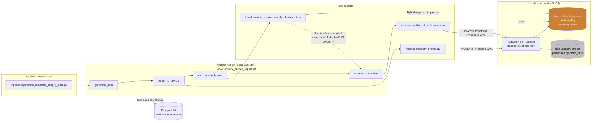

# CartCo Lakehouse — Current-State Architecture (Week 2)

This diagram reflects only what is actually built and verified running as of Week 2. It does not include Amazon, in-store Kafka, SFTP distributor, Gold marts, or any other planned-but-unbuilt component — those remain in `docs/B1_Design_Doc.pdf` as target-state scope, not here.

Verified against a live run of the `shopify_bronze_ingestion` Airflow DAG on 2026-07-14 (run id `manual__2026-07-14T01:30:19+00:00`), all 4 tasks succeeded and `silver.shopify_orders` was confirmed to hold 50,000 rows via an independent PyIceberg read-back. Evidence: [`../screenshots/`](../screenshots/).

## Component notes

- **`generate_synthetic_shopify_data.py`** — produces the seeded, 50,000-row synthetic Shopify orders CSV consumed by the rest of the pipeline. Runs first as the `generate_data` task.
- **`shopify_bronze.py`** — reads that CSV and writes `bronze.shopify_orders` as an Iceberg table via the REST catalog, partitioned by `ingestion_date`, with a partition-level idempotent overwrite.
- **`ge_bronze_shopify_checkpoint.py`** — reads `bronze.shopify_orders` back out (PyIceberg scan → pandas) and runs 8 Great Expectations checks against it (null checks, source-valid `status` set, numeric ranges, schema guards, row-count bound) using the GX 0.18.19 Fluent API (`context.sources.add_pandas` → `context.get_validator` → per-expectation validator method calls). Raises `RuntimeError` on any failure, which fails the Airflow task and halts the DAG before Silver ever runs.
- **`silver_shopify_orders.py`** — reads `bronze.shopify_orders`, deduplicates on `order_id` (keeping the latest `order_date`), drops rows with unrecoverable nulls, canonicalizes `status` → `order_status` (`delivered→completed`, `cancelled→cancelled`, `returned→refunded`), derives `order_total`, and writes `silver.shopify_orders` partitioned by `order_date` with a date-range idempotent overwrite.
- **Iceberg REST catalog** (`tabulario/iceberg-rest`) — the single catalog both Bronze and Silver writes and reads go through; backs the `bronze` and `silver` namespaces against MinIO.
- **MinIO** — S3-compatible object storage backing every Iceberg table (data files + metadata files).
- **Postgres 14** — Airflow's metadata database; stores DAG/task state, not lakehouse data.
- **Airflow (LocalExecutor)** — orchestrates the 4 tasks in a strict linear chain; no parallel branches yet, since Silver has a single hard dependency (a clean Bronze).
